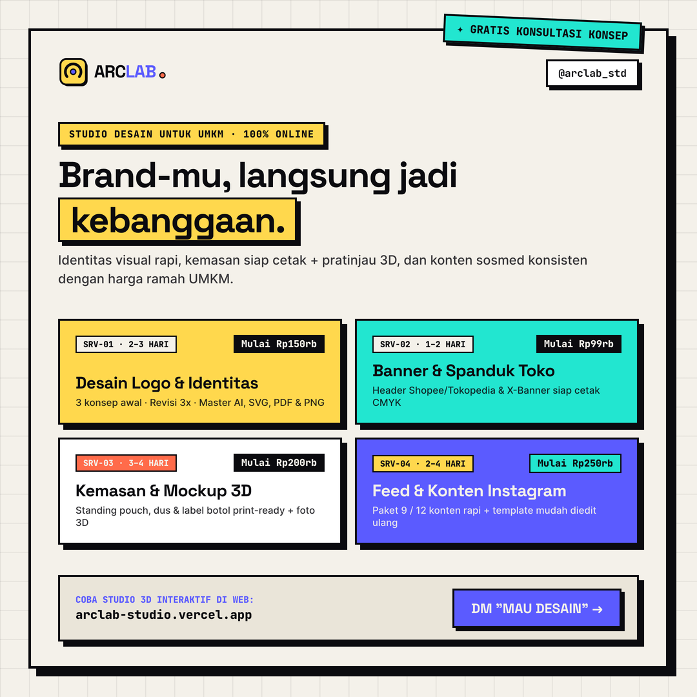
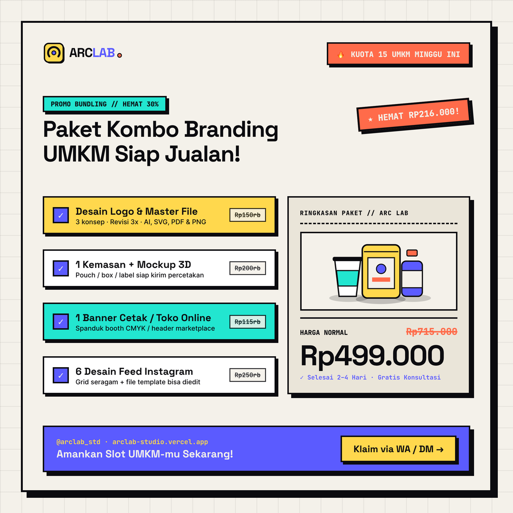

# Laporan Praktik Promosi Digital — Arc Lab

**Nama Brand / Usaha:** Arc Lab  
**Bidang Usaha:** Jasa Kreatif Desain Grafis (Logo, Banner, Kemasan + Mockup 3D, Feed Instagram)  
**Model Layanan:** 100% Online (Konsultasi via WhatsApp/Zoom, Pengiriman File Master HD & Siap Cetak)  
**Instagram:** `@arclab_std` (`https://instagram.com/arclab_std`)  
**Website:** `https://arclab-studio.vercel.app`  
**Penyusun:** Arya Rachman I (`241011402689` / `05TPLM004`) — Digital Entrepreneurship (Semester 5)

---

## a. Produk / Jasa yang Dipromosikan

**Arc Lab** adalah studio jasa desain grafis kreatif yang membantu pelaku UMKM, pebisnis online, dan brand lokal membangun identitas visual yang kontras, rapi, dan konsisten agar produk lebih menonjol serta dipercaya oleh calon pelanggan.

### 1. Daftar Layanan dan Paket Harga

| Layanan | Deskripsi Singkat | Estimasi Harga |
| :--- | :--- | :--- |
| **Desain Logo & Identitas** | 3 konsep awal berbeda, revisi terarah hingga 3x, file master lengkap (AI/EPS/SVG/PDF/PNG) + panduan warna & font | Mulai Rp150.000 |
| **Desain Banner / Spanduk** | Desain banner marketplace/toko online (Shopee, Tokopedia, website) atau spanduk/X-banner cetak CMYK resolusi tinggi | Mulai Rp99.000 |
| **Desain Kemasan & Mockup 3D** | Desain label botol, *standing pouch*, atau *box* produk siap kirim percetakan (*print-ready dieline*) + foto *mockup* 3D realistis | Mulai Rp200.000 |
| **Desain Feed Instagram** | Paket 9 atau 12 konten feed/carousel seragam selaras palet brand + file template mudah diedit ulang | Mulai Rp250.000 |
| **Paket Kombo Branding UMKM** | **Logo + 1 Desain Kemasan + 1 Banner Promosi + 6 Feed Instagram** *(Hemat 30% / Rp216.000)* | **Rp499.000** *(Harga normal Rp715.000)* |

### 2. Keunggulan Layanan (*Unique Selling Proposition*)
1. **Harga ramah UMKM:** Paket harga transparan tanpa biaya tersembunyi, terjangkau bagi usaha rintisan maupun berkembang.
2. **Pengerjaan cepat (2–4 hari kerja):** Alur kerja 4 tahap yang ringkas dan terpantau dari diskusi brief hingga serah terima file.
3. **Konsultasi konsep gratis:** Klien bebas berdiskusi mengenai arah visual dan kebutuhan cetak melalui WhatsApp sebelum memesan.
4. **File master lengkap & siap cetak:** Seluruh aset diserahkan dalam resolusi tinggi (AI, EPS, SVG, PDF CMYK, dan PNG transparan).

### 3. Identitas Visual (Neo-Brutalist Lab) dan Website Resmi Arc Lab
Selaras dengan tampilan website resmi, identitas visual **Arc Lab** mengusung gaya **Neo-Brutalist Lab** yang memadukan latar hangat **Paper (`#F4F1EA`)** berpola *lab grid* tipis dengan garis tepi tegas **Ink (`#0B0B0F`, border 2–3px)** serta bayangan solid tanpa kabur (*hard offset shadow*). Palet aksen menggunakan empat warna kontras tinggi: **Lab Yellow (`#FFD84D`)**, **Electric Indigo (`#5B5BFF`)**, **Mint Cyan (`#22E6D0`)**, dan **Vibrant Coral (`#FF6B4A`)**, dipadukan dengan sistem tipografi **`Space Grotesk`** (judul utama), **`Inter`** (teks isi), dan **`JetBrains Mono`** (label teknis & harga). Simbol logo menampilkan kotak kuning Neo-Brutalist berisi **busur terbuka (*open arc*)** dengan **titik fokus indigo** di tengah serta *wordmark* **"ARCLAB"** beraksen titik koral.

Pada kanal Instagram resmi **`@arclab_std`**, identitas ini diterapkan pada foto profil rasio 1:1 (`instagram-kit/logo-profile-1x1.png`) dan susunan bio ringkas yang mengarahkan audiens ke pusat layanan digital di **`https://arclab-studio.vercel.app`**. Website resmi tersebut dibangun menggunakan **Nuxt 3 (Vue 3), Tailwind CSS, dan Three.js**, menghadirkan pengalaman **Studio Mockup 3D Fotorealistik** pada bagian *hero*, fitur interaktif **Konfigurator Produk & Brand Kit 3D** (pengunjung dapat mengetik nama mereknya sendiri dan melihat hasilnya pada 10 produk 3D secara langsung), penggeser **Before vs After Rebranding** dengan studi kasus kemasan **Kopi Senja** yang selaras dengan tampilan *hero* dan konfigurator 3D, **Kalkulator Paket Harga Otomatis**, serta tombol *Call-to-Action* (CTA) langsung ke ruang chat WhatsApp Arc Lab.

---

## b. Penentuan Target Pasar

| Dimensi Segmentasi | Detail Target Pasar |
| :--- | :--- |
| **Usia** | **20 – 40 tahun** (mahasiswa wirausaha, perintis bisnis online, hingga pemilik UMKM yang sedang melakukan pembaruan identitas visual/*rebranding*). |
| **Lokasi** | Fokus utama di kota-kota besar dan penyangga di Indonesia (**Jabodetabek, Bandung, Surabaya, Yogyakarta, Semarang, Medan, Makassar**), serta menjangkau seluruh wilayah Indonesia karena layanan dilakukan 100% secara online. |
| **Minat & Perilaku** | - Pelaku UMKM di bidang kuliner (F&B), *fashion*, *skincare*/kosmetik lokal, kerajinan (*craft*), dan kedai kopi. - Penjual aktif di ekosistem digital seperti Instagram, TikTok Shop, Shopee, dan Tokopedia. - Memiliki ketertarikan pada topik *branding*, kemasan produk, pemasaran digital, dan pengembangan bisnis. - Terbiasa mencari referensi desain di Instagram serta lebih nyaman berkonsultasi langsung melalui WhatsApp. |
| **Masalah Utama (*Pain Points*)** | Keterbatasan waktu dan keahlian menggunakan perangkat lunak desain, tampilan kemasan dan media sosial masih polos/kurang kontras dibanding kompetitor, serta kebingungan menentukan arah visual brand yang siap cetak sejak awal. |

---

## c. Materi Promosi Digital

### 1. Profil & Postingan Instagram / Facebook (`@arclab_std`)

**Pengaturan Akun Instagram `@arclab_std`:**
- **Nama Profil:** `Arc Lab | Desain Logo, Kemasan & Sosmed UMKM`
- **Foto Profil 1:1:** `instagram-kit/logo-profile-1x1.png` *(Emblem kotak kuning `#FFD84D` berbusur terbuka + titik indigo `#5B5BFF` dan pelat wordmark `ARCLAB.` di atas latar `#F4F1EA` lab grid)*
- **Bio Instagram:**
  > 🎨 Studio Desain UMKM · 100% Online  
  > ✦ Logo · Kemasan + 3D · Banner · Feed IG  
  > ⚡ Mulai Rp99rb | Beres 2–4 Hari  
  > 👇 Coba 3D Brand Mixer & Konsultasi Gratis:  
  > 🔗 `arclab-studio.vercel.app`

  
*Keterangan gambar: Desain visual `assets/postingan-instagram.png` (`instagram-kit/01-feed-intro-katalog.png`) mengusung gaya Neo-Brutalist Lab yang identik dengan website Arc Lab (`#F4F1EA` paper grid, border tegas `#0B0B0F`, bayangan solid, serta kartu Bento kuning `#FFD84D`, cyan `#22E6D0`, putih-koral `#FF6B4A`, dan indigo `#5B5BFF`).*

**Deskripsi Visual Postingan:**  
Poster rasio 1:1 (1080 × 1080 px) bergaya **Neo-Brutalist Lab** khas website Arc Lab. Bagian atas menampilkan logo resmi **ARCLAB**, penanda akun `@arclab_std`, dan stiker miring *"✦ GRATIS KONSULTASI KONSEP"*. Bagian utama memuat *headline* **`"Brand-mu, langsung jadi kebanggaan."`** dengan sorotan blok kuning `#FFD84D`, diikuti susunan *Bento Grid* 4 kartu layanan (Logo Mulai Rp150rb, Banner Mulai Rp99rb, Kemasan & Mockup 3D Mulai Rp200rb, Feed IG Mulai Rp250rb) serta pita bawah yang menampilkan alamat web `arclab-studio.vercel.app` dan tombol **`DM "MAU DESAIN" →`**.

**Caption Instagram / Facebook:**
> Produk sudah digarap serius, tapi tampilan kemasan dan sosmed masih terasa kurang meyakinkan? 🤔  
> Sering kali calon pembeli menilai keseriusan sebuah brand dari **kesan pertama** saat melihat logo, kemasan produk, dan kerapian feed Instagram-mu.
>
> **Arc Lab** (`@arclab_std`) siap membantu bisnismu tampil lebih rapi, kontras, dan profesional lewat layanan desain grafis 100% online:  
> ✅ **Desain Logo & Identitas** — 3 konsep awal, revisi 3x, file master lengkap (AI/SVG/PNG/PDF)  
> ✅ **Desain Kemasan & Mockup 3D** — Label, *pouch*, dan *box* siap cetak + foto *mockup* 3D  
> ✅ **Desain Banner / Spanduk** — Tajam dan menarik untuk marketplace maupun cetak CMYK  
> ✅ **Desain Feed Instagram** — Paket 9 atau 12 konten seragam + template bisa diedit ulang
>
> 💡 **Harga ramah UMKM mulai dari Rp99.000!**  
> 💬 **GRATIS konsultasi konsep** sebelum order & pengerjaan cepat **2–4 hari kerja**.
>
> Coba ketik nama brand-mu di studio 3D interaktif kami **`arclab-studio.vercel.app`** atau langsung DM kata **"MAU DESAIN"** ke `@arclab_std` untuk diskusi kebutuhan brand-mu! 🚀
>
> `#ArcLab` `#JasaDesainGrafis` `#JasaDesainLogo` `#DesainKemasan` `#Mockup3D` `#DesainFeedInstagram` `#JasaDesainBanner` `#BrandingUMKM` `#UMKMNaikKelas` `#StudioDesain`

---

### 2. Iklan Digital (Meta Ads & Google Search Ads)

#### A. Desain & Copywriting Meta Ads (Instagram Ads & Facebook Ads)

  
*Keterangan gambar: Desain materi iklan `assets/iklan-digital-ads.png` (`instagram-kit/02-feed-promo-kombo-ads.png`) mengadaptasi komponen Kalkulator Harga pada website Arc Lab dengan stempel koral `★ HEMAT RP216.000!`, daftar centang 4 layanan, ilustrasi produk 3D, dan kartu ringkasan harga `Rp499.000`.*

- **Primary Text (Teks Utama):**
  > Ingin tampilan produk dan media sosial bisnismu naik kelas tanpa ribet desain sendiri? ✨
  >
  > Lewat **Paket Kombo Branding UMKM** dari **Arc Lab (`@arclab_std`)**, kamu langsung mendapatkan seluruh kebutuhan visual utama dalam satu paket hemat:  
  > ✔️ Desain Logo + File Master Lengkap (AI/SVG/PNG/PDF)  
  > ✔️ 1 Desain Kemasan Siap Cetak + Mockup 3D  
  > ✔️ 1 Desain Banner Marketplace / Cetak CMYK  
  > ✔️ 6 Desain Feed Instagram Konsisten
  >
  > 🔥 **Hemat 30% (Rp216.000) — Hanya Rp499.000** *(dari harga normal Rp715.000)*!  
  > ⚡ Pengerjaan 2–4 hari kerja | 🔄 Termasuk revisi | 💬 Konsultasi konsep gratis!
  >
  > Kuota promo dibatasi untuk **15 UMKM pertama minggu ini**. Klik tombol di bawah untuk konsultasi gratis & klaim paketmu melalui WhatsApp! 👇
- **Headline:** Paket Kombo Branding UMKM — Hemat 30% di Arc Lab!
- **Description:** Logo + Kemasan 3D + Banner + 6 Feed IG • Rp499rb • Konsultasi Gratis
- **Call-to-Action (CTA) Button:** `Kirim Pesan WhatsApp` (*Send WhatsApp Message*)
- **Pengaturan Kampanye:**
  - *Campaign Objective:* Engagement / Pesan (*Click-to-WhatsApp*)
  - *Target Lokasi & Usia:* Indonesia (kota besar & penyangga), usia 20–40 tahun, minat UMKM/bisnis online/branding
  - *Placement:* Instagram Feed, Instagram Stories, Instagram Reels, dan Facebook Feed
  - *Anggaran (Budget):* **Rp50.000/hari × 7 hari = Rp350.000**

#### B. Copywriting Google Search Ads
- **Kata Kunci Target (*Keywords*):** `jasa desain logo umkm`, `jasa desain kemasan produk`, `jasa desain feed instagram`, `studio desain grafis online`
- **Headline 1:** Arc Lab | Jasa Desain Grafis UMKM Mulai Rp99rb
- **Headline 2:** Paket Branding Hemat 30% — Logo, Kemasan & Feed IG
- **Headline 3:** Pengerjaan 2–4 Hari | Coba Mockup 3D Gratis di Web
- **Description:** Bangun identitas visual profesional bersama Arc Lab. Layanan 100% online untuk desain logo, kemasan siap cetak + mockup 3D, banner & feed IG. Konsultasi gratis!

---

### 3. WhatsApp Broadcast dan Email Marketing

#### A. Pesan WhatsApp Broadcast
> Halo Kak [Nama]! 👋  
> Semoga usaha dan penjualannya minggu ini lancar terus ya! 😊
>
> Perkenalkan, kami dari **Arc Lab** (`@arclab_std`) — studio desain grafis online untuk UMKM. Minggu ini kami sedang membuka **Promo Paket Kombo Branding UMKM (Hemat 30%)** seharga **Rp499.000** *(normal Rp715.000)* yang sudah mencakup:  
> ✨ Desain Logo + File Master Lengkap  
> ✨ 1 Desain Kemasan Siap Cetak + Mockup 3D  
> ✨ 1 Desain Banner Marketplace / Spanduk  
> ✨ 6 Desain Feed Instagram
>
> Tersedia juga layanan satuan mulai **Rp99.000** dengan pengerjaan cepat **2–4 hari kerja** dan **GRATIS konsultasi konsep** sebelum memesan. Kakak juga bisa mencoba simulasi nama brand pada kemasan 3D secara langsung di `https://arclab-studio.vercel.app`.
>
> Jika Kakak ingin tanya-tanya dulu atau melihat daftar paket lengkapnya, cukup balas pesan ini dengan ketik **"INFO"** ya Kak. Terima kasih! 🙌
>
> Salam hangat,  
> **Tim Arc Lab (`@arclab_std`)**

#### B. Email Marketing
- **Subject Line:** `Upgrade Identitas Visual Bisnismu — Hemat 30% Paket Branding UMKM di Arc Lab`
- **Preheader:** `Dapatkan desain logo, kemasan + mockup 3D, banner, dan feed Instagram siap pakai dengan konsultasi gratis.`
- **Isi Email:**
  > Halo **[Nama Penerima]**,
  >
  > Tampilan visual yang rapi, kontras, dan konsisten membantu produk UMKM lebih mudah dikenali sekaligus meningkatkan kepercayaan calon pembeli saat berbelanja di media sosial maupun marketplace.
  >
  > Jika saat ini Anda sedang menyiapkan peluncuran produk baru atau ingin memperbarui tampilan brand, **Arc Lab** siap membantu melalui layanan desain grafis 100% online yang praktis dan terarah:
  > - **Desain Logo (mulai Rp150.000):** 3 konsep awal, revisi 3x, dan file master lengkap.
  > - **Desain Banner / Spanduk (mulai Rp99.000):** Siap pasang di marketplace maupun media cetak CMYK.
  > - **Desain Kemasan + Mockup 3D (mulai Rp200.000):** File siap cetak (*print-ready*) dilengkapi pratinjau *mockup* 3D.
  > - **Desain Feed Instagram (mulai Rp250.000):** Paket 9 atau 12 konten selaras dengan karakter brand.
  >
  > **Penawaran Spesial Minggu Ini:**  
  > Nikmati **Paket Kombo Branding UMKM (Logo + 1 Kemasan + 1 Banner + 6 Feed IG)** hanya dengan **Rp499.000** *(hemat 30% dari harga normal Rp715.000)* untuk 15 pendaftar pertama.
  >
  > 👉 **[Konsultasi Konsep Gratis via WhatsApp Sekarang]**  
  > Atau coba fitur interaktif **3D Brand Mixer** kami di: `https://arclab-studio.vercel.app`
  >
  > Salam kreatif,  
  > **Arc Lab (`@arclab_std`)**

---

## d. Simulasi Promosi dan Analisis Respons Pelanggan

> **Catatan Penting:** Seluruh angka jangkauan, interaksi, *leads*, transaksi, dan omzet pada bagian ini merupakan **DATA SIMULASI** yang disusun untuk keperluan uji coba dan analisis akademik tugas mata kuliah, bukan data riil hasil kampanye komersial.

Simulasi dijalankan selama **7 hari** pada empat kanal promosi: (1) Postingan Organik Instagram/Facebook (`@arclab_std`), (2) Meta Ads (*Click-to-WhatsApp*) dengan total anggaran Rp350.000, (3) WhatsApp Broadcast ke 100 kontak pelaku usaha, dan (4) Email Marketing ke 150 kontak prospek.

### 1. Tabel Hasil Simulasi Uji Coba Promosi (7 Hari)

| Kanal Promosi *(Simulasi)* | Reach / Terkirim | Interaksi / Klik | CTR / Response Rate | Leads *(Chat Masuk)* | Closing *(Order)* | Omzet *(Rp)* |
| :--- | :---: | :---: | :---: | :---: | :---: | :---: |
| **Postingan Organik IG/FB** | 850 akun | 151 interaksi *(94 likes, 18 komentar, 27 saves, 12 shares)* | Engagement Rate: **17,76%** *(151/850)* | 6 | 1 *(1 Feed IG)* | Rp250.000 |
| **Meta Ads (IG & FB Ads)** *(Biaya: Rp350.000)* | 6.400 akun *(8.900 impresi)* | 192 klik tombol WA | CTR: **2,16%** *(192/8.900)* | 34 | 5 *(2 Logo, 1 Kemasan, 2 Paket Kombo)* | Rp1.498.000 |
| **WhatsApp Broadcast** | 100 kontak *(96 terbaca)* | 22 balasan pesan | Response Rate: **22,00%** *(22/100)* | 14 | 2 *(1 Banner, 1 Kemasan)* | Rp299.000 |
| **Email Marketing** | 150 email *(42 dibuka / OR 28,0%)* | 11 klik tombol CTA | CTR: **7,33%** *(11/150)* | 4 | 1 *(1 Logo)* | Rp150.000 |
| **TOTAL SIMULASI** | **7.500 audiens** | — | **Konversi Leads ke Order: 15,52%** *(9/58)* | **58 leads** | **9 order** | **Rp2.197.000** |

**Rincian Perhitungan Metrik Utama (Simulasi):**
- **Rincian Omzet per Kanal:**
  - *Organik IG/FB:* 1× Desain Feed IG (Rp250.000) = **Rp250.000**
  - *Meta Ads:* 2× Desain Logo (Rp300.000) + 1× Desain Kemasan (Rp200.000) + 2× Paket Kombo UMKM (Rp998.000) = **Rp1.498.000**
  - *WhatsApp Broadcast:* 1× Desain Banner (Rp99.000) + 1× Desain Kemasan (Rp200.000) = **Rp299.000**
  - *Email Marketing:* 1× Desain Logo (Rp150.000) = **Rp150.000**
  - *Total Omzet:* `Rp250.000 + Rp1.498.000 + Rp299.000 + Rp150.000` = **Rp2.197.000**
- **ROAS (*Return on Ad Spend*) Meta Ads:** `Rp1.498.000 / Rp350.000` = **4,28x**
- **Cost per Lead (CPL) Meta Ads:** `Rp350.000 / 34 leads` = **Rp10.294 per lead** *(atau rata-rata biaya promosi terhadap seluruh 58 leads = Rp6.034 per lead)*.

### 2. Contoh Respons Pelanggan (Simulasi)
- **Komentar pada Postingan Instagram (`@arclab_std`):**
  - `@kopisenja.id`: *"Kak, tadi barusan coba ketik nama brand di web 3D-nya keren banget! Kalau bikin logo baru sekalian stiker botol kopi kena berapa ya?"*
  - `@dapurmama_rina`: *"Suka banget sama gaya desain Neo-Brutalist-nya yang tegas & rapi! Mau tanya paket 9 feed IG dong kak, sudah saya DM ya."*
- **Pesan Masuk pada WhatsApp Arc Lab:**
  - *Calon Klien 1 (dari Meta Ads — UMKM Camilan):* *"Halo Arc Lab, saya lihat iklan Paket Kombo Rp499rb di Instagram. Kebetulan mau launching keripik kemasan standing pouch minggu depan, apakah kuota promonya masih ada?"*
  - *Calon Klien 2 (dari WhatsApp Broadcast — Penjual Shopee):* *"INFO kak. Saya lagi butuh desain banner toko Shopee buat promo akhir bulan, pengerjaannya berapa hari?"*

### 3. Tiga Pertanyaan Paling Sering Muncul (FAQ)
1. **Contoh Portofolio Spesifik:** Calon klien meminta contoh hasil desain yang relevan dengan bidang usaha mereka (terutama kuliner, *coffee shop*, dan *fashion*).
2. **Durasi Pengerjaan & Ketentuan Revisi:** Calon klien menanyakan kepastian waktu pengerjaan (apakah bisa selesai dalam 2–4 hari kerja) serta batas cakupan revisi 3x.
3. **Kesiapan File untuk Percetakan:** Pelaku UMKM menanyakan apakah ukuran pola pisau (*dieline*), mode warna (CMYK), dan garis potong file kemasan/banner sudah langsung siap diserahkan ke pihak percetakan.

### 4. Analisis Respons Pelanggan per Kanal
1. **Meta Ads (Instagram & Facebook Ads):** Menjadi penggerak utama akuisisi pelanggan baru dengan menyumbang **34 dari 58 leads (58,62%)** dan **Rp1.498.000 dari Rp2.197.000 total omzet (68,18%)**. Penawaran diskon 30% pada Paket Kombo dengan tampilan kartu harga bergaya struk sangat efektif menarik pemilik UMKM yang membutuhkan solusi lengkap.
2. **WhatsApp Broadcast:** Menghasilkan tingkat respons tertinggi (**22,00%**) karena pesan dikirim ke daftar kontak yang sudah memiliki kedekatan (*warm audience*), sehingga proses tanya-jawab hingga transaksi berlangsung lebih singkat.
3. **Postingan Organik Instagram/Facebook (`@arclab_std`):** Mencatatkan *engagement* yang sehat, khususnya pada metrik *saves* (**27 kali disimpan**). Visual kontras Neo-Brutalist memudahkan pembaca memindai harga dan menyimpan postingan sebagai referensi.
4. **Email Marketing:** Memberikan kontribusi konversi langsung paling kecil dalam waktu 7 hari (**1 order**), tetapi efektif mengarahkan prospek mencoba simulasi produk di website `arclab-studio.vercel.app` sehingga memperkuat kredibilitas studio.

---

## e. Laporan Sederhana: Strategi dan Hasil Uji Coba

### 1. Ringkasan Strategi Promosi (*Marketing Funnel*)
Strategi promosi digital **Arc Lab** disusun mengikuti tiga tahapan *funnel* yang selaras antara akun `@arclab_std` dan website interaktif:
- **Awareness (Pengenalan):** Menjangkau pemilik UMKM sasaran melalui visual kontras bergaya **Neo-Brutalist Lab** (`#F4F1EA` paper, `#FFD84D` yellow, `#22E6D0` cyan, `#5B5BFF` indigo) pada feed `@arclab_std` serta dukungan iklan Meta Ads.
- **Consideration (Pertimbangan):** Mengedukasi calon klien lewat konten perbandingan *Before vs After* kemasan, transparansi kalkulator harga, serta pengalaman mencoba langsung **Studio Mockup 3D & Brand Mixer** di `arclab-studio.vercel.app` ditambah konsultasi konsep gratis.
- **Conversion (Konversi):** Menyederhanakan alur pemesanan langsung ke WhatsApp (*Click-to-WhatsApp*) yang dipadukan dengan penawaran bernilai tinggi (**Paket Kombo Branding UMKM Rp499.000 — Hemat 30%**) dan batasan kuota 15 UMKM per minggu.

### 2. Ringkasan Hasil Simulasi Uji Coba (7 Hari)
- **Total Biaya Promosi:** **Rp350.000** *(anggaran Meta Ads Rp50.000/hari selama 7 hari; kanal organik, WA Broadcast, dan Email tidak menggunakan biaya iklan)*.
- **Total Leads Terkumpul:** **58 prospek** *(CPL Meta Ads: Rp10.294)*.
- **Total Pesanan Berhasil (*Closing*):** **9 pesanan** *(tingkat konversi dari leads ke order sebesar 15,52%)*.
- **Total Omzet Simulasi:** **Rp2.197.000** *(dengan Rp1.498.000 berasal dari Meta Ads)*.
- **ROAS Meta Ads:** **4,28x** (`Rp1.498.000 / Rp350.000`), menunjukkan bahwa secara simulasi anggaran iklan mampu menghasilkan pendapatan lebih dari empat kali lipat biaya yang dikeluarkan.

### 3. Evaluasi dan Kendala
- **Aspek yang Berhasil:** Penggabungan empat layanan menjadi **Paket Kombo Branding UMKM (Rp499.000)** efektif meningkatkan nilai transaksi rata-rata, sementara fitur interaktif pratinjau 3D di `arclab-studio.vercel.app` membuat calon klien lebih cepat memahami nilai tambah layanan kemasan Arc Lab.
- **Kendala yang Ditemukan:** Sekitar 40% prospek dari iklan berbayar berhenti merespons setelah menanyakan harga karena mereka ingin melihat contoh portofolio spesifik per industri secara cepat di dalam ruang chat sebelum memutuskan memesan.

### 4. Rekomendasi Optimasi ke Depan
1. **Menyusun Katalog Portofolio Sektoral (PDF & Highlight `@arclab_std`):** Menyiapkan PDF ringkas dan *Story Highlights* per kategori usaha (Kuliner, Coffee Shop, Fashion, Skincare) agar dapat dikirimkan dalam hitungan detik saat prospek menghubungi WhatsApp.
2. **Memproduksi Konten Video Pendek (*Reels* / TikTok):** Merekam layar interaksi *Brand Mixer 3D* di website dan proses transformasi *Before–After* kemasan produk untuk meningkatkan jangkauan organik `@arclab_std`.
3. **Menerapkan *Follow-Up* Terjadwal pada H+2:** Menghubungi kembali prospek WhatsApp yang belum memesan pada H+2 dengan mengirimkan pratinjau tangkapan layar nama brand mereka dari *Studio 3D Arc Lab* secara gratis sebagai pemantik diskusi.
